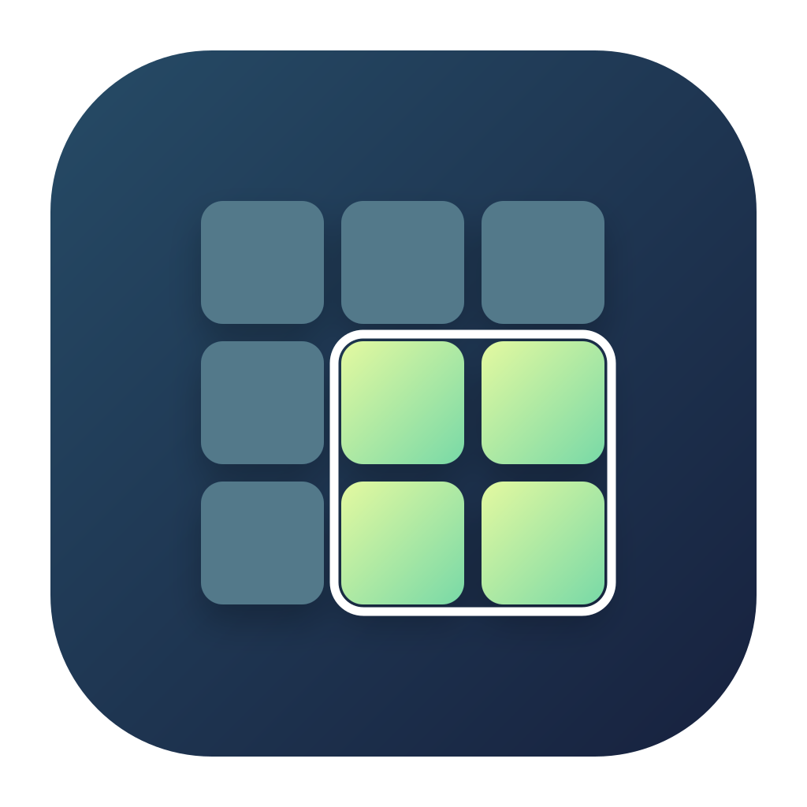

#  vindustilpasser

<p align="center"></p>

vindustilpasser is a native macOS menu-bar utility for positioning windows of other applications. It uses AppKit, Accessibility, and Carbon hotkeys. It has no Dock icon or normal application menu.

- Move and resize windows with a grid panel, keyboard arrows, or a finer grid mode.
- Save and restore a window's size and position for each monitor and resolution.
- Apply built-in or custom window presets from the panel or with global hotkeys.
- Customize the grid and shortcuts, and optionally launch at login.

## Build and run

Requires macOS 13 or later and Xcode Command Line Tools. Full Xcode is not needed.

```sh
make build
open build/vindustilpasser.app
```

For installation, signing, tests, and releases, see [development.md](development.md).

## Use

Press Command-F11 to open the positioning grid for the active window. Drag across cells and release to move and resize it. Arrow keys move the selection; Shift-arrow keys resize it. Hold Option for a finer grid. Press Return to apply or Escape to cancel. Clicking outside the grid or switching the active app or window closes it.

Command-F10 fills the usable screen without entering macOS fullscreen. Change grid size and add your own presets and shortcuts in Settings (Command-comma).

With the grid panel open, press Command-S to save the selected window's exact position and size, or Command-L to restore it. A Restore button appears when a saved frame matches the window, monitor, and resolution; click it to restore. Change these panel-only shortcuts in Settings → General. Settings → Saved Windows lists saved frames and lets you delete them.

Saved frames use the app's Accessibility document URL or window identifier to recognize a window. For apps that provide neither, the app matches by bundle ID and window type when only one window of that type is open. If another matching window opens, save and restore are paused until only one remains. Apps can reuse identifiers, so those windows may still be unsafe to recognize across launches. Display coordinates are stored relative to the monitor, in macOS points, without grid snapping. Apps may still enforce their own minimum sizes or placement limits.

In Settings → General, enable **Launch at login** to add the installed app to your user’s Login Items. Turn it off to remove the app. If macOS requires approval, allow the app in System Settings → General → Login Items.

Grant vindustilpasser Accessibility access when prompted, or in System Settings → Privacy & Security → Accessibility. Some apps restrict how their windows can be resized.

## Settings screenshot


## Q&A

1. **What inspired vindustilpasser?** 

 - [Divvy](https://mizage.com/divvy/), a grid-based window manager. Its [Mac App Store version](https://apps.apple.com/us/app/divvy-window-manager/id413857545) was last updated in 2019, and it's still Intel-only.

2. **What does the name mean?** 

 - Try translating from Norwegian.

3. **What's the best way to install it?**

 - Clone this repository, then run `make build && make deploy` from its directory.

4. **Why does macOS block the app from the DMG?**

 - The DMG contains an ad-hoc signed, unnotarized app. If you trust the download, copy the app to Applications and try opening it. Then go to System Settings → Privacy & Security → **Open Anyway** and confirm. See [Apple's guidance](https://support.apple.com/en-ie/102445).

5. **Can we use macOS system keyboard shortcuts to manage windows?**

 - Yes, but less flexibly. Аnd system management works visibly slower because of animations.
